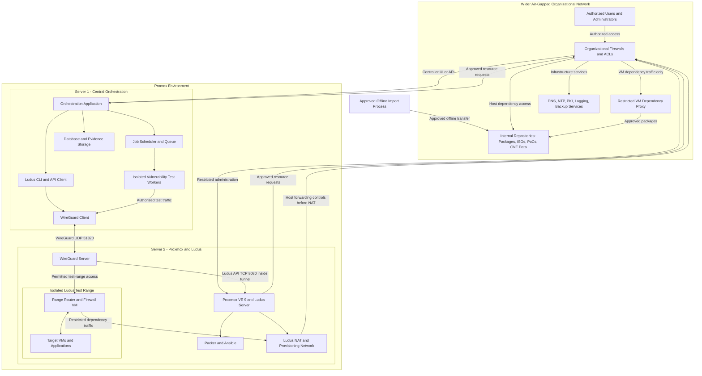
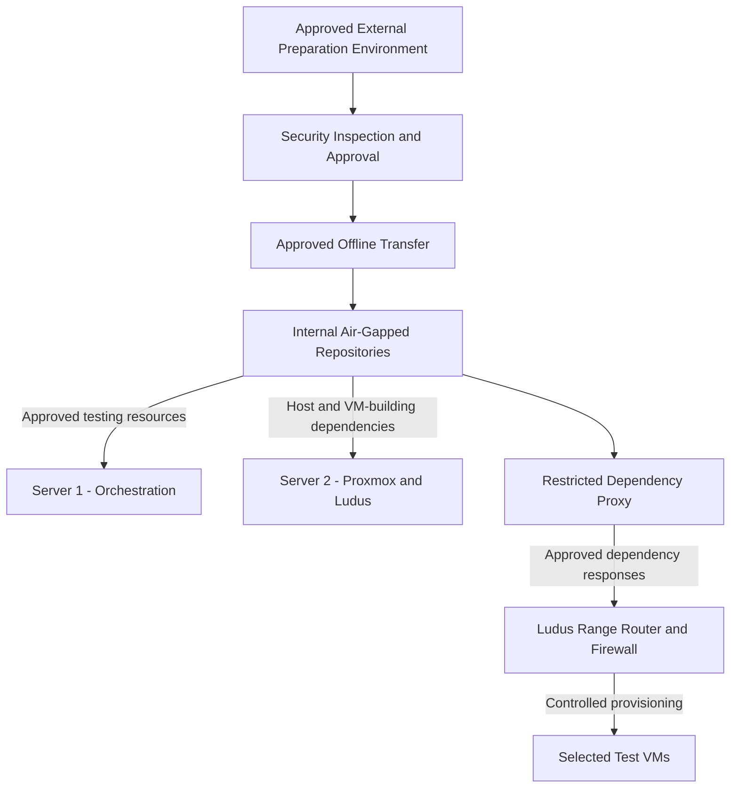
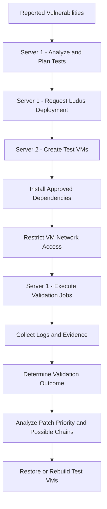

# Promox Two-Server Architecture — Shared Air-Gapped Network

**Status:** Reviewed against Ludus and Proxmox documentation, October 2026.

**Scope:** Both servers connect to the organization's existing air-gapped network. Neither has internet access.

- Server 1 is the central controller responsible for orchestration and vulnerability testing.
- Server 2 runs Proxmox, Ludus, and the virtual machines.
- Server 1 remotely controls Ludus on Server 2.
- Both servers retrieve approved software and dependencies from internal repositories.
- Test VMs remain isolated, with tightly restricted access to approved internal dependencies.

---

## 1. Recommended Architecture

Allow both servers to connect directly to the wider air-gapped network, but separate management traffic, software dependencies, and vulnerability-testing traffic.

This design simplifies offline dependency management because Server 2 can obtain approved software directly from internal repositories instead of transferring everything through Server 1.

**The main security requirement is ensuring that vulnerable test VMs cannot freely access the wider organizational network.**

### 1.1 Network Architecture Diagram



### 1.2 How the Network Connections Work

**Connection A: Server 1 to Server 2**

Server 1 controls Ludus remotely through the WireGuard tunnel and Ludus API.

**Connection B: Server 1 to Internal Repositories**

Server 1 retrieves vulnerability data, approved PoCs, testing tools, and application dependencies directly from the internal repositories.

**Connection C: Server 2 to Internal Repositories**

Server 2 retrieves Proxmox packages, Ludus dependencies, Packer plugins, Ansible content, and operating-system images through approved network paths.

**Connection D: Server 1 to Test VMs**

Isolated testing workers connect to authorized test VMs through WireGuard and the Ludus network. They execute vulnerability tests and collect evidence.

**Connection E: Test VMs to Internal Repositories**

Approved test VMs obtain dependencies through the Ludus range router, restricted forwarding/NAT path, organizational firewall, and dependency proxy.

**Important:** VM access to internal repositories is conditional, not unrestricted. Repository access should normally be enabled during provisioning and disabled during active vulnerability testing.

---

## 2. Server 1 — Central Orchestration and Testing

Server 1 manages the complete vulnerability-validation workflow.

| Component | Purpose |
|---|---|
| Debian Linux | Host operating system. |
| Orchestration Application | Central application that coordinates vulnerability testing. |
| Ludus CLI / API Client | Remotely controls Ludus on Server 2. |
| WireGuard Client | Provides secure access to Ludus and permitted test-range networks. |
| Job Scheduler / Queue | Organizes concurrent vulnerability tests, retries, and execution status. |
| Isolated Testing Workers | Run Nuclei, Metasploit, approved PoCs, and other validation tools. |
| Database | Stores vulnerabilities, test jobs, results, and execution history. |
| Evidence Storage | Stores logs, screenshots, test output, and supporting evidence. |
| Vulnerability Analysis | Correlates findings, identifies possible vulnerability chains, and supports patch prioritization. |
| Firewall and Access Controls | Restrict controller, worker, and network access. |
| Secrets Management | Protects API keys, credentials, and testing secrets. |
| Monitoring and Logging | Tracks health, errors, jobs, and security events. |
| Backup and Recovery | Protects controller configuration, findings, and evidence. |

### Server 1 Responsibilities

1. Receive reported vulnerabilities for validation.
2. Determine which testing tools and test environments are required.
3. Instruct Ludus on Server 2 to provision or restore test VMs.
4. Schedule and execute vulnerability tests.
5. Collect and analyze validation results.
6. Identify possible vulnerability chains.
7. Produce evidence-based findings and remediation recommendations.
8. Retrieve approved tools and updates from internal repositories.

**Security requirement:** Test workers must be isolated from the main controller and its credentials.

PoCs should execute inside dedicated test workers, not directly inside the orchestration application's main process.

---

## 3. Server 2 — Proxmox, Ludus, and Virtual Machines

Server 2 is dedicated to virtualization and maintaining reproducible test environments.

| Component | Purpose |
|---|---|
| Debian 13 / Proxmox VE 9 | Host operating system and virtualization platform. |
| QEMU / KVM | Runs virtual machines using hardware virtualization. |
| Ludus Server and API | Receives remote commands and manages test ranges. |
| Ansible | Configures test VMs and installs applications. |
| Ansible Roles and Collections | Reusable configuration content needed by Ludus deployments. |
| Packer | Builds reusable VM templates from operating-system images. |
| Packer Plugins and Templates | Provide the build definitions and integrations required for VM creation. |
| WireGuard Server | Provides secure remote access to Ludus and test ranges. |
| Linux Bridges and Internal VLANs | Connect and isolate virtual machines within Ludus. |
| Range Router / Firewall VM | Controls routing, firewall rules, DHCP, and DNS within each range. |
| dnsmasq | Provides DHCP and DNS for Ludus's host-side provisioning/NAT network. |
| NAT / Provisioning Network | Supports template building and the upstream connection used by range routers. |
| Operating-System ISOs | Supply the operating systems used to create VM templates. |
| VM Templates | Allow repeatable creation of test systems. |
| VM Applications and Test Targets | Provide the software and systems being tested. |
| VM Storage and Snapshots | Support restoration, repeatability, and test isolation. |
| Host Firewall and Access Controls | Restrict host management, forwarding, and VM network access. |
| Monitoring and Logging | Tracks host, virtualization, and Ludus health. |
| Backup and Recovery | Protects configurations, templates, and necessary VM data. |

### Important Ludus Details

Ludus installs or configures several required components itself, including:

- Ansible
- Packer
- WireGuard
- dnsmasq
- Virtual networking
- NAT and range configuration

These components do not necessarily need separate manual installation.

Ludus also creates:

- A WireGuard network, normally using `wg0`.
- A NAT/provisioning network, normally using `vmbr1000`.
- Separate virtual switches for individual ranges.
- A router/firewall VM for each range.

The range router provides internal network services, including DNS using AdGuard Home. Windows domain-joined VMs may use their domain controller for DNS.

**Recommendation:** For a new deployment, use a supported bare-metal installation path rather than assuming a customized existing Proxmox host will be compatible.

**Do not install Docker on the Ludus host.** Ludus warns that Docker can interfere with its networking. Container-based test workers should run on Server 1 instead.

---

## 4. Network Segmentation and Connections

The architecture should maintain three logical security zones.

These do not necessarily require three physical network interfaces.

### 4.1 Network Segments

| Network Segment | Connected Systems | Purpose |
|---|---|---|
| Management Network | Server 1, Server 2, authorized administrators | Ludus management, Proxmox administration, monitoring, and maintenance. |
| Repository / Services Network | Both servers through approved network routes | Internal software, ISOs, packages, DNS, NTP, and backup services. |
| Isolated Test Networks | Ludus range routers and virtual machines | Vulnerability validation without unrestricted access to organizational resources. |

A separate VM dependency proxy or controlled egress path should connect selected test VMs to approved repositories.

**Important:** Organizational VLANs and Ludus test VLANs are different networking layers. Test VMs must not be bridged directly into organizational management or repository VLANs.

### 4.2 Network Security Rules

| Source | Destination | Access Rule |
|---|---|---|
| Server 1 | Server 2 Ludus API | Allow through WireGuard. |
| Server 1 | Authorized test VMs | Allow approved testing traffic only. |
| Server 1 | Internal repositories | Allow approved services and ports. |
| Server 2 host | Internal repositories | Allow approved host dependency downloads. |
| Authorized administrators | Proxmox / Ludus management | Restrict access to management services. |
| Test VMs | Internal repositories | Allow only through approved dependency proxy when required. |
| Test VMs | Organizational management networks | Deny. |
| Test VMs | Unrelated organizational systems | Deny. |
| Test VMs | Other test VLANs | Deny by default; allow only required testing paths. |
| Test VMs | Internet | Deny; the environment has no internet connection. |

### 4.3 Important Network Ports

| Connection | Protocol / Port | Purpose |
|---|---|---|
| Server 1 to Server 2 | UDP 51820 | Default Ludus WireGuard tunnel. |
| Server 1 to Ludus API | HTTPS TCP 8080 inside WireGuard | Ludus remote management. |
| Authorized administrators to Proxmox | HTTPS TCP 8006 | Proxmox management interface. |
| Authorized administrators to servers | TCP 22 | SSH maintenance. |
| Servers to internal repositories | TCP 443 or configured repository port | Approved dependency downloads. |
| Servers to internal DNS | UDP/TCP 53 | Internal name resolution. |
| Servers to internal NTP | UDP 123 | Time synchronization. |
| Approved test VMs to dependency proxy | Configured proxy port | Controlled package and application downloads. |

These are defaults or common examples. Actual ports depend on the deployment and repository configuration.

Additional lab-only ports, including RDP, WinRM, SSH, SMB, and application-specific services, depend on the vulnerabilities being tested.

**Do not expose lab-only services to the wider organizational network by default.**

---

## 5. Internal Resources and Offline Dependencies

The wider air-gapped network should provide approved internal repositories that both servers can access.

### 5.1 Required and Conditional Resources

| Resource | Used By |
|---|---|
| Debian APT Repository | Server 1, Server 2, and applicable Linux VMs. |
| Proxmox APT Repository | Server 2. |
| Ludus Installation Files and Dependencies | Server 2; Ludus client files on Server 1. |
| Ansible Galaxy Roles and Collections | Ludus on Server 2. |
| Packer Plugins and Templates | Ludus on Server 2. |
| Operating-System ISO Repository | Server 2 for VM template creation. |
| Windows Updates / WSUS | Applicable Windows test VMs. |
| Python Package Repository | Server 1 workers and applicable VMs. |
| Go Modules and Build Dependencies | Components built from Go source. |
| Container Image Registry | Server 1 workers and selected guest VMs. |
| Nuclei Templates | Server 1 vulnerability-testing workers. |
| Metasploit Modules | Server 1 vulnerability-testing workers. |
| Approved Vulnerability PoCs | Isolated testing workers. |
| CVE Records and Security Advisories | Server 1 analysis and orchestration. |
| Application Installers and Libraries | Applicable test VMs. |
| Firmware Images and Drivers | Firmware or hardware-related tests. |
| DNS and NTP | Both hosts and permitted VMs. |
| Internal Certificates / PKI | Services requiring trusted encrypted connections. |
| Logging and Backup Services | Both servers and designated supporting components. |

Not every dependency is required for every test. The complete offline inventory must be determined from the selected Ludus version, operating systems, templates, applications, and validation tools.

### 5.2 How Resources Enter the Air-Gapped Network



### 5.3 Offline Resource Transfer Process

1. Collect the required software, packages, updates, PoCs, and vulnerability data in an approved preparation environment.
2. Verify software signatures, hashes, sources, and versions.
3. Review the resources according to organizational security policies.
4. Transfer approved resources into the air-gapped environment.
5. Store resources in internal repositories with version and approval records.
6. Allow Server 1 to retrieve testing resources.
7. Allow Server 2 to retrieve Ludus, Proxmox, and VM-building dependencies.
8. Permit selected VMs to retrieve only necessary dependencies through controlled network paths.

**Important:** Internal mirrors do not automatically guarantee successful offline Ludus installation.

The installer, operating-system packages, Ansible dependencies, Packer plugins, template downloads, and all referenced resources must be verified for offline compatibility.

---

## 6. Vulnerability-Testing Workflow



### Workflow Details

**Step 1 — Receive Vulnerabilities**

Server 1 receives reported vulnerabilities and identifies their affected software, versions, and testing requirements.

**Step 2 — Prepare Test Environments**

Server 1 instructs Ludus to provision the required virtual machines on Server 2.

**Step 3 — Install Dependencies**

Server 2 and approved test VMs retrieve necessary software from internal repositories.

**Step 4 — Apply Network Isolation**

Unnecessary VM access to the wider network is removed before testing.

**Step 5 — Execute Validation**

Server 1 assigns tests to isolated workers, which communicate with authorized test VMs.

**Step 6 — Collect Evidence**

Server 1 stores logs, outputs, and results.

**Step 7 — Analyze Results**

Promox determines whether a vulnerability is:

- Confirmed.
- Not reproduced.
- Inconclusive.

A failed reproduction does not automatically prove a false positive.

**Step 8 — Correlate Findings**

Promox identifies possible vulnerability chains and assesses which patches could reduce the greatest risk.

**Step 9 — Restore Environments**

Test VMs are restored or rebuilt to ensure clean and repeatable testing.

---

## 7. Critical Security Requirements

### 7.1 Block Test VM Access to Management Networks

Test VMs must not directly access:

- Proxmox management interfaces.
- Ludus administrative services.
- Server 1's controller database or secrets.
- Organizational administration systems.
- Unrelated internal servers.

### 7.2 Restrict Ludus Network Defaults

Ludus allows outbound and inter-VLAN traffic by default.

For this architecture, recommended restrictive settings include:

```yaml
network:
  external_default: REJECT
  inter_vlan_default: REJECT
```

Add explicit exceptions only where the test requires them.

These settings are not sufficient by themselves to enforce all host-level and organizational-network security requirements.

### 7.3 Use a Controlled Proxy for Test VM Dependencies

Allow approved VMs to access only specified dependency services.

Recommended controls:

- Approved destination addresses.
- Approved ports and protocols.
- Restricted download operations.
- Authentication where supported.
- Request logging.
- Access disabled when no longer needed.

Alternatively, dependencies may be staged into VMs without providing guest network access.

### 7.4 Enforce Security Before NAT

Ludus uses NAT for outbound traffic.

Upstream firewalls may see test VM traffic as originating from Server 2.

Therefore:

- Enforce VM-specific restrictions at the range router.
- Apply host forwarding rules before source NAT.
- Restrict the dependency proxy independently.
- Do not rely exclusively on Server 2's IP address to identify trusted traffic.

### 7.5 Keep Testing Separate From Provisioning

During provisioning:

- Allow required dependency downloads.
- Verify installed software versions.
- Prepare clean snapshots.

During testing:

- Remove unnecessary repository access.
- Block connections to unrelated internal systems.
- Permit only required testing traffic.

Ludus testing mode can assist with blocking external traffic and taking snapshots, but it should not be the only isolation control.

Stopping testing mode can restore snapshots and remove its temporary traffic restrictions. Persistent deny rules are still required.

### 7.6 Protect Proxmox and Ludus

- Restrict administrative access.
- Protect API keys and credentials.
- Limit who can upload Ansible roles and Packer templates.
- Restrict the Ludus API to approved management access.
- Keep the Ludus admin API local unless explicitly required.
- Avoid installing unnecessary services on the hypervisor.

Ludus documents security trade-offs, including disabled CPU security mitigations for performance. Treat Server 2 as a dedicated trusted laboratory host rather than a general-purpose shared virtualization server.

### 7.7 Prevent Network Address Conflicts

Ludus commonly uses:

- `198.51.100.0/24` for WireGuard.
- `192.0.2.0/24` for its default NAT/provisioning network.
- `10.<range-number>.0.0/16` for individual ranges.

Check these networks against existing organizational routing before deployment.

These are Ludus's documented default address ranges, not suggested organizational management subnets.

### 7.8 Protect Evidence and Recovery

- Keep security logs and evidence protected.
- Maintain backups outside the two production servers.
- Back up the orchestration database and configuration.
- Back up critical virtualization configuration and templates.
- Test restoration procedures.
- Monitor available resources and service health.
- Verify network isolation after infrastructure changes.

Two physical servers do not provide high availability. Either server remains a possible single point of failure.

---

## 8. Application Gateway vs. Network Gateway

The architecture uses both functions for different purposes.

| Function | Recommended Component | Responsibility |
|---|---|---|
| Application Control | Server 1 | Coordinates vulnerability-testing workflows and issues authorized Ludus commands. |
| Network Routing | Existing organizational network infrastructure | Connects approved management and repository networks. |
| Network Filtering | Organizational and host firewalls | Restricts network traffic between security zones. |
| Test Range Routing | Ludus range router/firewall VM | Controls test VM traffic and internal test networks. |
| Dependency Access | Approved repository proxy | Restricts which internal resources selected VMs can retrieve. |

**Server 1 should not operate as an unrestricted network gateway.**

It should remain responsible for application orchestration while dedicated network infrastructure handles routing and security boundaries.

---

## 9. Comparison With the Previous Architecture

| Area | Previous Design: Only Server 1 Connected | New Design: Both Servers Connected |
|---|---|---|
| Server 1 role | Orchestration and controlled resource transfer | Orchestration and testing |
| Server 2 role | Proxmox and Ludus | Proxmox and Ludus |
| Server 2 dependency access | Through Server 1 | Directly from approved internal repositories |
| VM dependency access | Through Server 1-controlled paths | Through restricted proxy or approved staging |
| Resource management | More centralized through Server 1 | Shared internal repository services |
| Operational complexity | More transfer and gateway management | Simpler host dependency management |
| Network exposure | Smaller direct network footprint | Larger direct network footprint |
| Security requirements | Strong isolation around Server 1 | Strong host, organizational, and VM isolation |
| Server 1 failure | Interrupts orchestration and may interrupt dependency delivery | Interrupts orchestration; Server 2 can still access repositories |
| Ludus remote management | Server 1 | Server 1 |

---

## 10. Final Recommendation

Use the shared-network architecture if the organization can enforce reliable network segmentation and access controls.

### Server 1

Responsible for:

- Orchestration.
- Vulnerability validation.
- Testing workers.
- Ludus remote control.
- Evidence collection.
- Vulnerability correlation.
- Patch prioritization.

### Server 2

Responsible for:

- Proxmox virtualization.
- Ludus infrastructure.
- VM template building.
- VM provisioning.
- Virtual networking.
- Test environment isolation.
- Snapshot and restoration management.

### Wider Air-Gapped Network

Responsible for providing:

- Internal software repositories.
- Operating-system images.
- Approved dependency mirrors.
- Vulnerability information.
- DNS and NTP.
- Certificate infrastructure.
- Logging and backup services.
- Firewalls and network segmentation.

### Required Security Principle

**Both physical servers may access approved organizational services, but vulnerable test VMs must remain isolated and receive only the network access explicitly required for provisioning or testing.**

This provides simpler dependency management while keeping the vulnerability-validation environments separated from the organization's wider network.

---

## 11. Implementation Validation Checklist

Before declaring the architecture operational, verify:

- [ ] Both servers can reach only approved internal services.
- [ ] Server 1 can remotely control Ludus through WireGuard.
- [ ] The Ludus API is protected from unauthorized network access.
- [ ] Server 2 can install Proxmox and Ludus dependencies offline.
- [ ] Ansible roles and collections are available internally.
- [ ] Packer plugins and VM templates are available internally.
- [ ] Required operating-system ISOs and update packages are available.
- [ ] Ludus can successfully build and deploy test VMs.
- [ ] VM network ranges do not overlap organizational networks.
- [ ] Test VMs cannot access Proxmox or organizational management networks.
- [ ] Test VMs can access only approved dependency services during provisioning.
- [ ] VM dependency access can be disabled before testing.
- [ ] VM network restrictions remain effective despite NAT.
- [ ] Isolated testing workers cannot access controller secrets or unrelated systems.
- [ ] Vulnerability testing can run and collect evidence successfully.
- [ ] Test environments can be restored or rebuilt.
- [ ] Backups and recovery procedures have been tested.
- [ ] Firewall isolation has been tested after deployment and configuration changes.

---

## Verification Notes

This architecture distinguishes documented Ludus capabilities from recommended Promox design choices.

**Documented Ludus capabilities:**

- Remote CLI and API access using WireGuard.
- Proxmox-based virtualization.
- Packer template building.
- Ansible-based configuration.
- Internal Linux bridges and VLANs.
- Per-range router/firewall VMs.
- Host provisioning network and NAT.
- Configurable firewall rules and testing mode.

**Recommended Promox components, not automatically supplied by Ludus:**

- Central orchestration application.
- Vulnerability-testing workers.
- Job queue and scheduling.
- Vulnerability results database.
- Evidence management.
- Attack-chain analysis.
- Patch prioritization.
- Restricted repository proxy.
- Organization-wide firewall segmentation.
- Production backup and monitoring design.

**Deployment note:** The exact offline package inventory, firewall rules, IP addresses, storage configuration, and network interface assignments must be finalized against the selected Ludus release and the organization's existing infrastructure.


